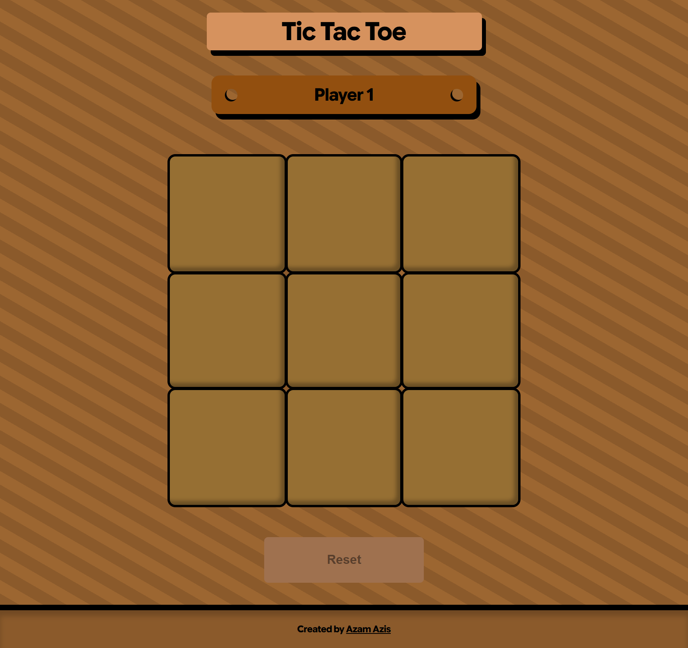

# The Odin Project - Tic Tac Toe

This is a solution to the [Tic Tac Toe](https://www.theodinproject.com/lessons/node-path-javascript-tic-tac-toe).

## Table of contents

- [The Odin Project - Tic Tac Toe](#the-odin-project---tic-tac-toe)
  - [Table of contents](#table-of-contents)
  - [Overview](#overview)
    - [The challenge](#the-challenge)
    - [Screenshot](#screenshot)
  - [My process](#my-process)
    - [Built with](#built-with)
    - [What I learned](#what-i-learned)
  - [Author](#author)

## Overview

### The challenge

- The main goal here is to have as little global code as possible.

### Screenshot



## My process

### Built with

- Semantic HTML5 markup
- CSS custom properties
- Flexbox
- CSS Grid
- Mobile-first workflow

### What I learned

- I learned about scope.

  - Global Variable

  ```js
  // This is a global variable. this variable can be access or available everywhere.
  const board = document.querySelector(".board");
  ```

  - Function Scope

  ```js
  // This is a function scope. When variables are created inside of a function, those variables are only ever available inside of that function.

  function go() {
    var funcNumber = 1;
  }
  ```

  - Block Scope

  ```js
  // This is a block scope. When variables are created inside oof a block, those variables are only ever available inside of that block.

  function Player() {
    let player = "";
  }
  ```

- I learned about closure
  Closure is the ability of a function to access outer scope.

```js
function Player() {
  let player = "";

  const setPlayer1 = () => {
    player = GameBoard.player[0].name;
  };
}
```

- I learned about factory function / function factory
  Factory function / function factory is a normal function that return new function or object.

```js
function Player() {
  let player = "";

  const setPlayer1 = () => {
    player = GameBoard.player[0].name;
  };
  const setPlayer2 = () => {
    player = GameBoard.player[1].name;
  };
  const getPlayer = () => player;

  return {setPlayer1, setPlayer2, getPlayer};
}
```

- I learned about IIFE (Immediately Invoked Function Expression)
  IIFE is an anonymous function which is executed as soon as it is defined.

```js
const GameBoard = (() => {
  const columns = 3;
  const rows = 3;
  const gameBoard = [];
  const player = [
    {
      name: "Player 1",
      choice: "x"
    },
    {
      name: "Player 2",
      choice: "o"
    }
  ];

  for (let i = 0; i < (columns * rows); i++) {
    gameBoard.push("");
  }

  /* Game Board Visualization
    [ 0 ] [ 1 ] [ 2 ]
    [ 3 ] [ 4 ] [ 5 ]
    [ 6] [ 7 ] [ 8 ]
  */

  return {gameBoard, player};
})();
```

## Author

- Twitter / X - [@AzamAzis01](https://x.com/AzamAzis01)
